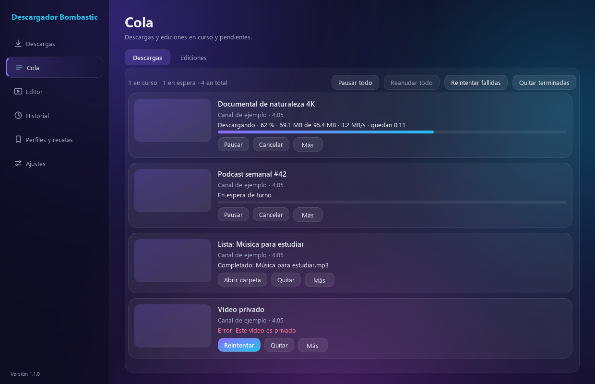
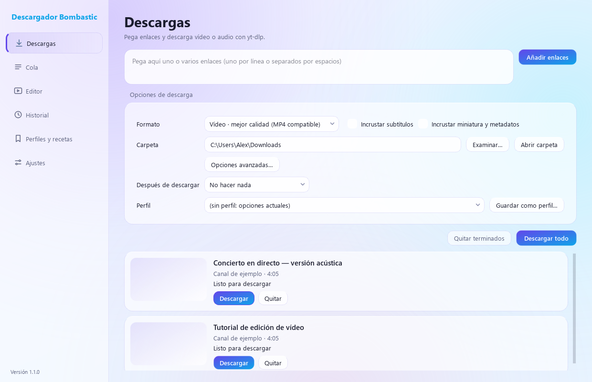
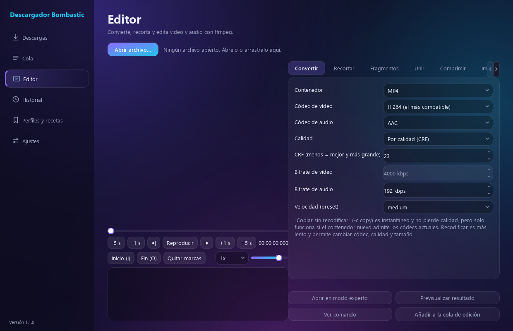

# Descargador Bombastic

**Descarga vídeo y audio de cientos de webs y edítalos, sin escribir comandos.**

Interfaz gráfica para Windows de [yt-dlp](https://github.com/yt-dlp/yt-dlp) y [ffmpeg](https://ffmpeg.org).

[Versión portable (zip, sin instalar)](https://github.com/AlexBo64/Descargador-Bombastic/releases/latest/download/DescargadorBombastic-Portable.zip)
· [Todas las versiones](https://github.com/AlexBo64/Descargador-Bombastic/releases)
· [Manual de usuario](descargador-bombastic/docs/manual_usuario.md)

  
  

## Qué hace

- **Descargas**: pega uno o varios enlaces (o arrástralos) y elige formato: vídeo hasta 4K,
  MP4 compatible, o solo audio en MP3, M4A, Opus, FLAC o WAV. Subtítulos, miniatura y
  metadatos incrustados con un clic.
- **Cola**: varias descargas a la vez, pausar y reanudar, reintentos automáticos y errores
  explicados en español. Se recupera al volver a abrir la app.
- **Todas las opciones de yt-dlp** en un modo avanzado con buscador, cookies del navegador para
  vídeos con inicio de sesión y selector manual de formatos.
- **Editor con ffmpeg**: convertir, recortar con marcadores I/O, unir, comprimir a un tamaño en
  MB, cambiar velocidad, audio, subtítulos, marca de agua, GIF, capturas y metadatos, con
  vista previa y aceleración por tarjeta gráfica.
- **Modo experto y recetas**: cualquier comando de ffmpeg con variables, guardado para reusar.
- **Después de descargar**: convierte, recorta o comprime solo, en cuanto termina la descarga.
- **Historial y perfiles**, actualizaciones de yt-dlp y ffmpeg desde la propia app, menú
  contextual del Explorador, bandeja del sistema y temas claro y oscuro.

  

## Instalación

1. Pulsa **Descargar para Windows** y abre `DescargadorBombastic-Setup.exe`.
2. Si Windows muestra "Windows protegió tu PC", pulsa **Más información → Ejecutar de todas
   formas**. Sale porque el programa no tiene firma de código (de pago), no porque sea dañino.
3. Se instala para tu usuario, sin pedir administrador. yt-dlp y ffmpeg ya van incluidos.

¿Prefieres no instalar nada? Descarga la **versión portable**, descomprímela y abre
`DescargadorBombastic.exe`: guarda todo en su propia carpeta.

## Para desarrolladores

El código, cómo compilarlo y la arquitectura están en
[`descargador-bombastic/README.md`](descargador-bombastic/README.md).

---

Eres responsable de respetar los derechos de autor y las condiciones de uso de cada web.
Descarga solo contenido que tengas derecho a guardar.
